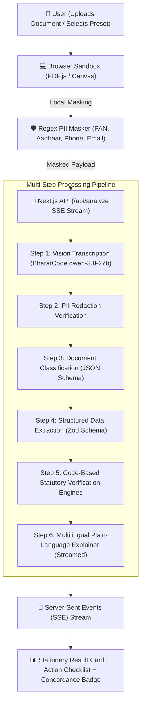
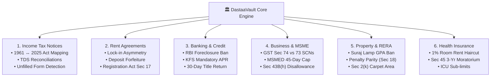

# 🏛️ DastaaVault — Project Brief & Executive Summary
### भारतीय दस्तावेज़ समीक्षक: Your Document, Decoded

> **Product:** DastaaVault  
> **Event:** BharatCode Build League 2026 Hackathon  
> **Tracks:** Work and Automation / Everyday Assistance  
> **Repository:** [github.com/Anhad-Sharma-26/dastaavault](https://github.com/Anhad-Sharma-26/dastaavault)  
> **Status:** Deployed & Live on Vercel | 37/37 Automated Tests Passing  

---

## 1. Executive Summary

**DastaaVault** is an open-source, privacy-first Indian statutory document reviewer and risk analysis platform powered by the **BharatCode Model API (`qwen-3.8-27b`)**.

Unlike generic LLM wrappers that hallucinate legal sections or violate user confidentiality by storing sensitive files on remote clouds, DastaaVault operates on a **zero-cloud-storage architecture** coupled with **deterministic, code-based statutory verification engines**. It ingests photos or PDFs of Indian legal and financial documents, redacts personally identifiable information (PII) entirely within the user's browser, performs multi-step vision transcription and classification, and returns plain-language explanations in **English, हिंदी (Hindi), or Hinglish** in under 30 seconds.

DastaaVault safeguards citizens, small business owners, tenants, borrowers, and policyholders across **6 critical statutory domains** with **18 interactive one-click presets**.

---

## 2. The Core Problem Space & Legal Landscape

Every day, millions of Indian citizens encounter complex notices, contracts, and fine-print agreements fraught with legal traps and statutory deadlines:

```
┌────────────────────────────────────────────────────────────────────────────────────────┐
│                                 THE DOCUMENT ANXIETY                                   │
├──────────────────────────┬─────────────────────────────┬───────────────────────────────┤
│ 1. Tax Law Overhaul      │ 2. Unlawful Banking Fees    │ 3. MSME 90-Day Credit Traps   │
│ 1961 Act replaced by     │ Prohibited foreclosure fees │ Buyers force 60-120d terms;   │
│ 2025 Act on 1 Apr 2026;  │ on floating home loans;     │ MSMED Act caps credit at 45d; │
│ 100s of sections altered │ APR omitted in KFS tables.  │ Sec 43B(h) tax disallowance.  │
├──────────────────────────┼─────────────────────────────┼───────────────────────────────┤
│ 4. GST Section 74 SCNs   │ 5. Real Estate GPA Bans     │ 6. Health Insurance Traps     │
│ 100% fraud penalties vs  │ Suraj Lamp (2011) GPA ban;  │ 1% room rent haircut on OT/   │
│ 10% standard penalty;    │ 18% buyer delay fees vs     │ surgery; unaware of Sec 45    │
│ Sec 75(4) hearing skips. │ ₹5 builder compensation.    │ 3-year moratorium shield.     │
└──────────────────────────┴─────────────────────────────┴───────────────────────────────┘
```

1. **The Historic Tax Law Overhaul (1 April 2026):**  
   India replaced the 65-year-old *Income-tax Act, 1961* with the *Income-tax Act, 2025*. Section numbers were comprehensively overhauled under the official ICAI concordance table (e.g. return processing intimation `143(1)` became `270(1)`, inquiry `142(1)` became `268`, reassessment `148` became `280`, and demand notice `156` became `290`; preliminary draft whitepapers had initially sequenced these in the 220s before the final parliamentary enactment). Generic AI models trained on older datasets hallucinate obsolete provisions or fail to cross-map old notices.
2. **Hidden Banking & Loan Traps:**  
   Lenders frequently charge 2–4% prepayment penalties on floating-rate individual home loans in direct violation of binding RBI Master Directions (`DBOD.No.Dir.BC.107/2011-12`), or omit the mandatory Annual Percentage Rate (APR) from the Key Fact Statement (KFS).
3. **The 90-Day MSME Credit Trap & Section 43B(h):**  
   Corporate buyers routinely impose 60 to 120-day credit terms on Micro and Small vendors. Section 15 of the MSMED Act 2006 strictly caps payment windows to 45 days. Unpaid invoices trigger 3x RBI compound penal interest (19.5% p.a.) and expose buyers to corporate income-tax disallowance under Section 43B(h).
4. **GST Show Cause Notices (Section 74 vs 73):**  
   Tax officers often classify routine clerical errors under Section 74 (willful suppression) to impose a 100% penalty instead of Section 73 (10% penalty), frequently skipping the mandatory personal hearing required by Section 75(4).
5. **Real Estate GPA Conveyance & Penalty Asymmetry:**  
   Promoters attempt property conveyance through General Power of Attorney (GPA) transfers—declared illegal by the Supreme Court in *Suraj Lamp (2011 11 SCC 787)*—or impose usurious 18% buyer delay fees while offering only ₹5/sq.ft. possession delay compensation, violating RERA Section 18 / Rule 15 parity.
6. **The 1% Health Insurance Room Rent Haircut:**  
   When a patient exceeds a 1% daily room rent cap, insurers apply a proportionate deduction that slashes **ALL** associate hospital charges (surgeon fees, operating theatre, anesthetist, nursing). Conversely, patients with 3+ continuous policy years are unaware of their absolute statutory immunity against claim repudiation under Section 45 of the Insurance Act 1938.

---

## 3. System Architecture & Harness Pipeline

DastaaVault uses a multi-tier streaming pipeline that guarantees deterministic legal fidelity and data privacy:



### Technology Stack
* **LLM Harness:** BharatCode Model API (`qwen-3.8-27b`) with automatic fallback to Google Gemini (`gemini-2.0-flash`), OpenAI, or Groq.
* **Frontend Framework:** Next.js 16 (App Router), React 19, TypeScript.
* **Styling & Design System:** Tailwind CSS v4, bespoke Hallmark Coral Stationery theme (letterpress tactile aesthetic, tabular typography, zero AI visual slop).
* **Validation & Schemas:** Zod v4 schemas for strict runtime payload validation.
* **Document Processing:** PDF.js for client-side rasterization and rendering.

---

## 4. The 6 Statutory Protection Packs



### Detailed Breakdown of Engines:

| Pack | Core Statutory Acts Covered | Deterministic Checks & Protections |
| :--- | :--- | :--- |
| **1. Income Tax Notices** | Income-tax Act, 1961<br>Income-tax Act, 2025 | • Cross-maps 1961 sections to 2025 equivalents via verified ICAI dataset.<br>• Reconciles Form 26AS/AIS TDS mismatch demands.<br>• Computes deadline countdowns in Indian Standard Time (IST).<br>• Detects unfilled blank statutory templates (e.g. Form 1, Form 7). |
| **2. Rent Agreements** | Transfer of Property Act, 1882<br>Registration Act, 1908 | • Identifies lock-in traps (`lock_in_months > notice_period_months`).<br>• Flags unfair deposit forfeiture clauses.<br>• Alerts when lease agreements $\ge 12$ months lack compulsory registration u/s 17.<br>• Flags annual escalation $> 10\%$. |
| **3. Banking & Loans (Wave 1)** | RBI Master Directions<br>Harmonized KFS Guidelines | • Enforces RBI prohibition on foreclosure/prepayment fees for floating individual loans.<br>• Flags missing Annual Percentage Rate (APR) in Key Fact Statements.<br>• Calendars statutory 30-day title deed release rule (₹5,000/day compensation). |
| **4. Business & MSME (Wave 2)** | CGST Act, 2017<br>MSMED Act, 2006<br>Income Tax Act Section 43B(h) | • Flags Section 74 fraud SCNs (100% penalty) vs Section 73 (10%).<br>• Detects omission of mandatory Section 75(4) personal hearings.<br>• Overrides payment terms exceeding 45 days as void ab initio.<br>• Computes compound penal interest at 3x RBI Bank Rate (19.5% p.a.).<br>• Flags Section 43B(h) buyer tax disallowance (Medium enterprises strictly exempt). |
| **5. Property & RERA (Wave 3)** | Supreme Court *Suraj Lamp (2011)*<br>RERA Act, 2016 (Sec 18, Rule 15, Sec 2(k)) | • Flags void property conveyance via General Power of Attorney (GPA).<br>• Enforces delay penalty parity: promoter compensation must equal buyer delay rate.<br>• Exposes super built-up loading factors ($>30\%$) and missing RERA carpet area.<br>• Flags tripartite subvention indemnity clauses. |
| **6. Health Insurance (Wave 3)** | Insurance Act, 1938 (Section 45)<br>IRDAI Health Regulations | • Computes exact proportionate deduction haircuts triggered by 1% room rent limits.<br>• Enforces Section 45 3-year incontestability moratorium defense.<br>• Flags illegal claim repudiations for pre-existing diseases after 36 continuous months.<br>• Warns of ICU daily sub-limits ($\le 2\%$). |

---

## 5. The 18 One-Click Test Presets Matrix

To allow judges, voters, and users to evaluate the system with zero quota friction or privacy concerns, DastaaVault includes 18 synthetic test presets with high-fidelity ground truth:

| # | Preset ID | Category | Document Name | Key Statutory Infraction Tested |
|---|---|---|---|---|
| 1 | `it-143-1` | Income Tax | Intimation u/s 143(1) (Clean) | TDS mismatch demand extraction of ₹12,450 |
| 2 | `it-new-act` | Income Tax | Intimation u/s 270(1) | New 2025 Act section corresponding to old 143(1) (ICAI Concordance) |
| 3 | `it-large-demand`| Income Tax | Demand Notice with Prosecution | ₹3.45L demand + Section 276C prosecution warning |
| 4 | `it-hindi` | Income Tax | Bilingual Inquiry u/s 142(1) | Hindi & English questionnaire testing multilingual OCR |
| 5 | `it-old-refund` | Income Tax | 1961 Act Refund Intimation | Assessment Year 2024-25 intimation with ₹8,200 refund |
| 6 | `it-148-photo` | Income Tax | Scanned Reassessment Notice | Skewed photo testing OCR and section 148 risk |
| 7 | `rent-clean` | Rent | Standard 11-Month Lease | Clean balanced lease agreement (zero flags) |
| 8 | `rent-lockin` | Rent | Lock-in Trap Agreement | 6-month lock-in against 1-month notice period |
| 9 | `rent-forfeiture`| Rent | Deposit Forfeiture Deed | Total loss of 3-month deposit on minor wear |
| 10 | `rent-12m` | Rent | 12-Month Unregistered Lease | Tenure $\ge 12$ months requiring compulsory registration |
| 11 | `rent-high-esc` | Rent | Excessive Escalation Agreement | 15% annual rent jump + 10 months security deposit |
| 12 | `bank-home-loan`| Banking | Home Loan Sanction & KFS | Unlawful 3% foreclosure fee + missing APR in KFS |
| 13 | `gst-drc01` | Business | Form GST DRC-01 (Sec 74) | 100% fraud penalty + missing hearing u/s 75(4) |
| 14 | `msme-45day` | Business | MSME Commercial Invoice | 90d clause voided by Sec 15; 19.5% interest & 43B(h) |
| 15 | `property-bba` | Property | Builder-Buyer Agreement | 18% buyer delay vs ₹5 builder compensation + GPA clause |
| 16 | `insurance-health`| Insurance | Health Policy Schedule | 1% room rent haircut + Section 45 3-year statutory moratorium defense (active policy tenure: 4 years) |
| 17 | `blurry` | Edge Case | Degraded Mobile Scan Notice | Blurry scan testing confidence fallback meter |
| 18 | `unrelated` | Edge Case | Electricity Utility Bill | Utility invoice testing safety rejection of unsupported docs |

---

## 6. Engineering Rigor & Quality Audits

### A. Ponytail Architecture & Quality Audit
A formal Ponytail codebase audit was executed, resulting in key hardening measures:
* **Section 43B(h) Statutory Accuracy:** Corrected engine to strictly exempt Medium enterprises (turnover $\le ₹250\text{Cr}$), ensuring 43B(h) applies solely to Micro and Small enterprises per statute.
* **GST Section Variant Normalization:** Added regex normalization to catch variants like `Section 74(1)`, `74A`, or `u/s 74`.
* **String-Formatted Number Parsing:** Handled string-based percentages (e.g. `"3.5%"`) in loan agreements.
* **Module Packaging:** Configured `"type": "module"` in `package.json` to eliminate ESM re-parsing overhead.

### B. Automated Test Suite (37 / 37 Passing)
The complete verification suite (`node tests/test-suite.mjs`) executes in $\sim 100\text{ ms}$:
* **PII Masking:** PAN, Aadhaar, Phone, Email format preservation and masking.
* **Section Mapping:** Cross-mapping between 1961 Act and 2025 Act provisions.
* **Zod Schemas:** Validation across Loan Sanction, GST Notice, MSME Invoice, Property Contract, and Insurance Policy data models.
* **Deterministic Rules:** Rigorous testing of statutory penalty thresholds, lock-in asymmetries, foreclosure charges, MSME credit ceilings, Suraj Lamp GPA bans, and Section 45 moratorium defenses.
* **Test Preset Integrity:** All 18 synthetic HTML documents verified for existence and content fidelity.

---

## 7. Privacy & Zero-Cloud-Storage Guarantee

1. **No Database / No Cloud Storage:** DastaaVault contains no database (Postgres, MongoDB, DynamoDB) and no cloud file buckets (S3). Documents exist strictly in volatile memory during the active request.
2. **Client-Side Redaction Before Transmission:**
   * **PAN:** `ABCPD1234K` $\rightarrow$ `ABCP****K`
   * **Aadhaar:** `1234 5678 9012` $\rightarrow$ `XXXX XXXX 9012`
   * **Phone:** `+91 9876543210` $\rightarrow$ `XXXXX43210`
   * **Email:** `taxpayer.help@domain.com` $\rightarrow$ `ta***@domain.com`
3. **Statutory Non-Legal Advice Framing:** All generated explanations prominently carry statutory disclaimers advising users to consult certified CAs, advocates, or RERA lawyers for formal proceedings.

---

## 8. Summary of Project Milestones

- [x] Implemented core OCR and vision pipeline with BharatCode `qwen-3.8-27b`.
- [x] Built client-side PII masker and PDF-to-image rasterizer.
- [x] Designed Hallmark Coral Stationery theme with letterpress aesthetics.
- [x] Integrated ICAI 1961 ↔ 2025 Income Tax statutory concordance table.
- [x] Implemented Wave 1: Banking & Key Fact Statement (KFS) protection.
- [x] Implemented Wave 2: Business, GST Section 74 SCNs & MSMED Act 45-day protection.
- [x] Implemented Wave 3: Real Estate RERA penalty parity, Suraj Lamp GPA ban & Health Insurance 1% room rent traps.
- [x] Expanded test suite to 37 automated tests with 100% pass rate.
- [x] Performed security scan: 0 hardcoded keys or leaked `.env` files in git history.
- [x] Deployed live production build to Vercel with automatic Gemini 2.0 Flash fallback.

---

*Built with pride for the BharatCode Build League 2026 Hackathon.*
