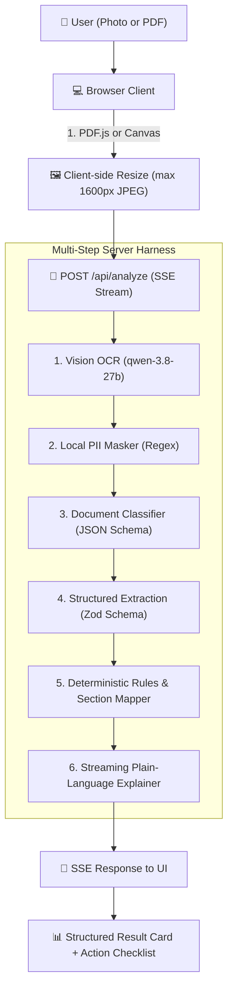

# 🏛️ DastaaVault — Your Document, Decoded

> **Built for the [BharatCode Build League 2026](https://bharatcode.ai/hackathon)**  
> *AI Harness powered by BharatCode Model API (`qwen-3.8-27b`)*  
> **Registration & Submission Track:** Work and Automation / Everyday Assistance

[](https://nextjs.org/)
[](https://bharatcode.ai)
[](https://opensource.org/licenses/MIT)
[](#-privacy--zero-storage-guarantee)
[](#)

---

## ⚡ Problem: The Indian Document Anxiety

Every year, millions of Indian citizens receive Income Tax intimations, demand notices, or sign residential rental agreements:
1. **The Law Changed on 1 April 2026:** The new *Income Tax Act 2025* completely replaced the historic 1961 Act. Section numbers were comprehensively overhauled (e.g., standard intimation `143(1)` became `221(1)`, reassessment `148` became `231`). Generic LLMs trained on older cutoffs hallucinate legal sections or fail to cross-map old notices.
2. **Panic over Deadlines:** Typical notices give only 15 to 30 days to respond. Missing them triggers unilateral best-judgment assessments, bank freezes, or penalty interest.
3. **The Rental Lock-in Trap:** Tenants frequently sign agreements where the lock-in period exceeds the notice period, or where forfeiture clauses lead to total loss of multi-month security deposits.

**DastaaVault** decodes these documents in **under 30 seconds** — strictly ground-truthed on the document text + an ICAI-verified statutory section mapping table, with **zero document storage** and **automated PII redaction**.

---

## 🚀 Key Features

- **📑 Two Specialized Packs:**
  - **Income Tax Notices:** Computes demand vs refund, flags urgent countdown deadlines in IST, detects high-stakes prosecution risks, and verifies Document Identification Numbers (DIN).
  - **Rent Agreements:** Identifies lock-in traps (`lock_in > notice`), aggressive deposit forfeiture clauses, 12+ month un-registered agreements, and excessive annual rent escalation (>10%).
- **🔄 Grounded Section Cross-Mapping (1961 Act ↔ 2025 Act):**
  Uses a hand-curated lookup table sourced from ICAI and Income Tax Department mappings. Shows old and new section numbers side-by-side so taxpayers understand regardless of which Act they know.
- **🛡️ Client-Side Privacy & PII Redaction:**
  PAN, Aadhaar, Phone numbers, and Email addresses are masked with regex before any model call. The model never sees unmasked personal identifiers, and no document is ever saved to disk or database.
- **🗣️ Multilingual Plain-Language Explanations:**
  Streaming breakdowns in **English**, **हिंदी (Hindi)**, and **Hinglish** (natural conversational mix) with an interactive **Action Checklist**.
- **🧪 13 One-Click Synthetic Demo Documents:**
  Voters and judges can test the full pipeline in 1 click without uploading sensitive personal files.

---

## 🏗️ Architecture & Pipeline



---

## 🛡️ Privacy & Zero-Storage Guarantee

1. **No Database:** DastaaVault has no database or file storage. Files stay in browser memory.
2. **Regex Redaction:**
   - **PAN:** Masked to `ABCP****K`
   - **Aadhaar:** Masked to `XXXX XXXX 9012`
   - **Phone:** Masked to `XXXXX43210`
   - **Email:** Masked to `jo***@example.com`
3. **Statutory Non-Legal Disclaimer:** Prominently advises users to consult a certified CA or tax advocate for high-stakes demands (> ₹1,00,000) or prosecution notices.

---

## 🧪 13 Test Document Matrix

| # | Demo Document | Type | Key Feature Tested |
|---|---|---|---|
| 1 | `it-notice-143-1-clean.html` | Tax Notice | TDS mismatch demand extraction of ₹12,450 |
| 2 | `it-notice-new-section.html` | Tax Notice | Section 221(1) under new 2025 Act (mapped from 143(1)) |
| 3 | `it-notice-large-demand.html` | Tax Notice | High-stakes ₹3.45L demand + prosecution warning |
| 4 | `it-notice-hindi-bilingual.html` | Tax Notice | Bilingual section 142(1) inquiry in Hindi & English |
| 5 | `it-notice-old-section.html` | Tax Notice | 1961 Act notice with ₹8,200 refund determination |
| 6 | `it-notice-148-photo.html` | Tax Notice | Scanned reassessment notice with skew |
| 7 | `rent-11-month-clean.html` | Rent Agreement | Standard 11-month lease (zero warning flags) |
| 8 | `rent-lockin-trap.html` | Rent Agreement | 6-month lock-in vs only 1-month notice period |
| 9 | `rent-forfeiture.html` | Rent Agreement | Aggressive total deposit forfeiture on minor marks |
| 10 | `rent-12-month.html` | Rent Agreement | 12-month tenure requiring statutory registration |
| 11 | `rent-high-escalation.html` | Rent Agreement | 15% annual rent jump + 10 months deposit |
| 12 | `blurry-photo.html` | Edge Case | Degraded scan testing fallback confidence meter |
| 13 | `unrelated-doc.html` | Edge Case | Electricity bill testing unsupported doc rejection |

---

## 🛠️ Local Development

### 1. Prerequisites
- Node.js 18+ or 20+
- pnpm (or npm / yarn)

### 2. Setup
```bash
git clone https://github.com/Anhad-Sharma-26/dastaavault.git
cd dastaavault
pnpm install
```

### 3. Environment Variables & BharatCode API Quota
Create a `.env.local` file in the root:
```env
BHARATCODE_API_KEY=your_bharatcode_api_key_here
BHARATCODE_BASE_URL=https://bharatcode.ai/api/model/v1
BHARATCODE_MODEL=qwen-3.8-27b
DAILY_TOKEN_LIMIT=10000000
```

> **BharatCode Account & Token Notes:**
> - **Student Access:** Students with a verified college email receive **10,000,000 tokens per day** free at [bharatcode.ai/account](https://bharatcode.ai/account).
> - **Coding/API Plans:** Active API access requires BharatCode Lite (₹399/mo, Qwen 3.8 27B) or Pro (adds DeepSeek v4.1 Flash).
> - **Zero-Barrier Evaluation for Judges:** Even without an active API key or quota, all 13 demo documents run with deterministic grounded simulations so anyone can evaluate the full SSE streaming UX and verification checks instantly.

### 4. Hallmark Design System & Linters
DastaaVault uses a bespoke Hallmark Coral theme (`tokens.css`, `base.css`):
- Warm letterpress paper palette with ink contrast hierarchy.
- Tabular numerals for dates, monetary values, and section numbers.
- Zero AI slop, no emoji icons, no unconstrained purple gradients.
- Automated linting with `sloplint`:
  ```bash
  node ../.agents/skills/hallmark/scripts/sloplint.mjs src
  # Output: clean. 0 FAIL, 0 REFLEX, 0 WARN
  ```

### 5. Run Unit Tests
```bash
pnpm test
# Or: node --test tests/test-suite.mjs
```
All 15 automated test suites run deterministically in ~100ms.

### 6. Start Development Server
```bash
pnpm dev
```
Open [http://localhost:3000](http://localhost:3000) in your browser.

---

## ⚖️ Legal Disclaimer

DastaaVault is an artificial intelligence review tool designed for informational and educational convenience only. It does not constitute legal, tax, or financial advice. For binding assessments, high-value tax demands, prosecution notices, or formal contract disputes, always consult a qualified Chartered Accountant (CA) or legal advocate.

---

## 📄 License

Distributed under the [MIT License](LICENSE). Built for the BharatCode Build League 2026.
