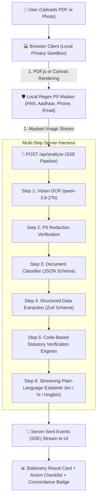

# 🏛️ DastaaVault — Indian Document Reviewer & Statutory Risk Analyzer
### भारतीय दस्तावेज़ समीक्षक: Your Document, Decoded

> **Built for the [BharatCode Build League 2026](https://bharatcode.ai/hackathon)**  
> *AI Harness powered by BharatCode Model API (`qwen-3.8-27b`)*  
> **Registration & Submission Track:** Work and Automation / Everyday Assistance  
> **Repository:** [github.com/Anhad-Sharma-26/dastaavault](https://github.com/Anhad-Sharma-26/dastaavault)

[](https://nextjs.org/)
[](https://bharatcode.ai)
[](tests/test-suite.mjs)
[](https://opensource.org/licenses/MIT)
[](#-privacy--zero-storage-guarantee)
[](#)

---

## ⚡ The Problem: The Indian Contract & Statutory Anxiety

Every day, millions of Indian citizens, homeowners, MSME suppliers, borrowers, and patients sign documents or receive official notices they cannot decipher:
1. **The Historic Tax Law Overhaul (1 April 2026):** India replaced the historic *Income Tax Act, 1961* with the *Income Tax Act, 2025*, comprehensively renumbering hundreds of statutory sections (e.g., standard intimation `143(1)` became `221(1)`, reassessments `148` became `231`). Generic LLMs hallucinate obsolete provisions or fail to cross-map old notices against the new framework.
2. **Hidden Foreclosure Penalties & Omitted APR:** Lenders routinely slip illegal 2–4% prepayment penalties on floating-rate individual loans in violation of RBI Master Directions, or omit the mandatory Annual Percentage Rate (APR) from the Key Fact Statement (KFS).
3. **The 90-Day MSME Credit Trap & Section 43B(h):** Buyers impose 60 to 120-day payment terms on small vendors. Under Section 15 of the MSMED Act, statutory credit is capped at 45 days. Unpaid invoices subject buyers to complete tax disallowance under Section 43B(h) and 3x RBI compound penal interest.
4. **GST Show Cause Notices (Section 74 vs 73):** Officers frequently invoke Section 74 (alleging fraud or willful suppression) rather than Section 73 (general error), triggering an automatic 100% penalty and frequently omitting the mandatory personal hearing required by Section 75(4).
5. **Real Estate GPA Conveyance & Penalty Asymmetry:** Builders still attempt General Power of Attorney (GPA) transfers—banned by the Supreme Court in *Suraj Lamp (2011 11 SCC 787)*—or impose 18% buyer delay fees while paying a meager ₹5/sq.ft. possession delay compensation, violating RERA Section 18 / Rule 15 parity.
6. **The 1% Health Insurance Room Rent Trap:** When a patient exceeds a 1% daily room rent cap, insurers execute proportionate deductions: scaling down **ALL** associated medical expenses (surgeon fees, operating theatre costs, anesthetist charges) by the room rent ratio. Conversely, patients with 3+ years of continuous policy coverage are unaware of their absolute immunity against claim repudiation under Section 45 of the Insurance Act 1938.

**DastaaVault** solves this in **under 30 seconds** — strictly ground-truthed on document text + deterministic statutory engines, with **zero cloud storage** and **client-side PII masking**.

---

## 🚀 The 6 Statutory Protection Packs

DastaaVault provides deterministic, zero-hallucination verification engines across 6 vital domains:

### 1. 📑 Income Tax Notices & Statutory Forms
* **1961 Act ↔ 2025 Act Concordance:** Verified ICAI statutory mapping table cross-references old and new sections side-by-side.
* **TDS Mismatch & Demand vs Refund:** Reconciles Form 26AS/AIS figures, computes deadline countdowns in IST, and verifies official Document Identification Numbers (DIN).
* **Unfilled Statutory Forms (e.g. Form 1, Form 7):** Identifies empty official templates, clarifies that no tax liability is assessed, and outlines filing prerequisites.

### 2. 🏠 Residential & Commercial Rent Agreements
* **Lock-in Traps:** Flags asymmetric clauses where `lock_in_months > notice_period_months`.
* **Security Deposit Forfeiture:** Detects unconscionable clauses forfeiting multi-month deposits on normal wear-and-tear.
* **Registration Act Section 17:** Alerts when leases $\ge 12$ months lack compulsory registration before the Sub-Registrar.
* **Escalation Cap:** Warns of excessive annual rent increases (>10%).

### 3. 🏦 Banking, Loans & Key Fact Statement (KFS)
* **RBI Foreclosure Fee Ban:** Enforces `DBOD.No.Dir.BC.107/13.03.00/2011-12` — 0% prepayment penalty on floating-rate individual term loans.
* **Mandatory APR Disclosure:** Enforces RBI's April 2024 Harmonized KFS Master Direction (`DOR.STR.REC.12/21.04.048/2024-25`).
* **Title Deed Return Protection:** Enforces `RBI/2023-24/60` — release of original title deeds within 30 days of loan closure or ₹5,000/day compensation.

### 4. 💼 Business, GST Notices & MSME Protection
* **GST DRC-01 Defense (Sec 74 vs 73):** Flags severe 100% fraud penalties and advises downgrading to Section 73 (10% penalty).
* **Section 75(4) Hearing Mandate:** Flags procedural invalidity when an adverse notice omits a personal hearing opportunity.
* **MSMED Act Section 15 & 16:** Overrides contractual payment terms exceeding 45 days as void; computes compound penal interest at 3x the RBI Bank Rate (19.5% p.a.).
* **Income Tax Section 43B(h):** Flags corporate tax expense disallowance for buyers failing to pay Micro and Small Enterprises within the statutory window (Medium enterprises strictly exempted).

### 5. 🏗️ Real Estate & RERA Property Conveyance
* **Supreme Court *Suraj Lamp* Ban (2011 11 SCC 787):** Immovable property can ONLY be transferred via a registered Sale Deed; flags void GPA/Agreement to Sell transactions.
* **RERA Section 18 / Rule 15 Delay Penalty Parity:** Promoter delay compensation MUST equal the interest rate charged to the allottee for installment delays (SBI MCLR + 2%).
* **RERA Section 2(k) Carpet Area Mandate:** Exposes excessive loading factors (>30%) and flags omission of net usable carpet area.
* **Tripartite Subvention Trap:** Protects buyers against clauses indemnifying developers for bank EMI defaults.

### 6. 🏥 Health Insurance Policy Schedules & IRDAI Safeguards
* **1% Room Rent Haircut Trap:** Exposes proportionate deduction clauses where choosing a room above the daily cap triggers massive haircuts across operating theatre, surgery, and doctor charges.
* **Section 45 Insurance Act (3-Year Moratorium Defense):** Detects continuous coverage $\ge 36$ months, establishing absolute statutory immunity against claim repudiation or cancellation for pre-existing conditions.
* **ICU Sub-limit Warnings:** Alerts policyholders to ICU caps $\le 2\%$ of Sum Insured.

---

## 🏗️ Architecture & Multi-Step Harness Pipeline



---

## 🛡️ Privacy & Zero-Storage Guarantee

1. **Zero Database / Zero Cloud Storage:** DastaaVault contains no cloud database, S3 bucket, or persistent file store. Files live strictly in ephemeral browser/server memory during the active request.
2. **Client-Side Masking Before Model Transmission:**
   - **PAN:** Masked to `ABCP****K`
   - **Aadhaar:** Masked to `XXXX XXXX 9012`
   - **Phone:** Masked to `XXXXX43210`
   - **Email:** Masked to `jo***@example.com`
3. **Statutory Non-Legal Disclaimer:** Prominently advises users to consult qualified CAs, tax advocates, or RERA lawyers for binding disputes.

---

## 🧪 18 Test Document Matrix (Instant 1-Click Evaluation)

Judges and voters can test the entire pipeline in 1 click across all 7 categories without uploading personal files:

| # | Preset Document | Domain | Key Statutory Feature Tested |
|---|---|---|---|
| 1 | `it-notice-143-1-clean.html` | Income Tax | TDS mismatch demand extraction of ₹12,450 |
| 2 | `it-notice-new-section.html` | Income Tax | Section 221(1) under new 2025 Act (mapped from 143(1)) |
| 3 | `it-notice-large-demand.html` | Income Tax | High-stakes ₹3.45L demand + Section 276C prosecution warning |
| 4 | `it-notice-hindi-bilingual.html` | Income Tax | Bilingual section 142(1) inquiry in Hindi & English |
| 5 | `it-notice-old-section.html` | Income Tax | 1961 Act notice with ₹8,200 direct refund confirmation |
| 6 | `it-notice-148-photo.html` | Income Tax | Scanned reassessment notice with realistic skew & stamps |
| 7 | `blurry-photo.html` | Edge Case | Degraded scan testing fallback extraction confidence meter |
| 8 | `rent-11-month-clean.html` | Rent Agreement | Standard balanced 11-month lease (zero warning flags) |
| 9 | `rent-lockin-trap.html` | Rent Agreement | 6-month lock-in vs only 1-month notice period (tenant trap) |
| 10 | `rent-forfeiture.html` | Rent Agreement | Aggressive total deposit forfeiture on minor wall wear |
| 11 | `rent-12-month.html` | Rent Agreement | 12-month tenure requiring compulsory statutory registration u/s 17 |
| 12 | `rent-high-escalation.html` | Rent Agreement | 15% annual rent jump + 10 months security deposit |
| 13 | `banking-home-loan-sanction.html` | Banking & Loans | Unlawful 3% foreclosure fee on floating loan + missing APR in KFS |
| 14 | `gst-drc01-notice.html` | Business & GST | Section 74 fraud SCN (100% penalty) + missing hearing u/s 75(4) |
| 15 | `msme-overdue-invoice.html` | Business & MSME | 90-day term voided by Sec 15 with 19.5% penal interest & 43B(h) risk |
| 16 | `property-builder-buyer-agreement.html` | Property & RERA | 18% buyer delay vs ₹5/sq.ft. builder compensation + Suraj Lamp GPA clause |
| 17 | `health-insurance-policy-schedule.html` | Health Insurance | 1% room rent haircut on surgery/OT + Section 45 4-year moratorium shield |
| 18 | `unrelated-doc.html` | Edge Case | Electricity utility bill testing unsupported safety rejection |

---

## 🎨 Design System: Hallmark Coral Stationery

DastaaVault is built using a custom Hallmark stationery design system (`tokens.css`, `base.css`):
- Warm letterpress paper textures with crisp, accessible ink typography.
- Tabular figures (`font-variant-numeric: tabular-nums`) for currency amounts, dates, and statutory sections.
- Letterpress stamps (`APPROVED`, `CRITICAL DEMAND`, `PROHIBITED FEE`, `1% ROOM RENT TRAP`, `SEC 45 PROTECTED`).
- Zero AI-generated slop, no generic purple gradients, and strict accessibility standards.

---

## 🛠️ Getting Started

### 1. Clone & Install
```bash
git clone https://github.com/Anhad-Sharma-26/dastaavault.git
cd dastaavault
npm install
```

### 2. Environment Variables
Create a `.env.local` file:
```env
BHARATCODE_API_KEY=your_bharatcode_api_key_here
BHARATCODE_BASE_URL=https://bharatcode.ai/api/model/v1
BHARATCODE_MODEL=qwen-3.8-27b
DAILY_TOKEN_LIMIT=10000000
```
*(Note: All 18 demo documents run in high-fidelity simulation mode even without an API key or quota!)*

### 3. Run Automated Tests
```bash
node tests/test-suite.mjs
```
All **37 automated verification tests** run deterministically in $\sim 60\text{ ms}$.

### 4. Build & Start Production Server
```bash
npm run build
npm start
```
Open [http://localhost:3000](http://localhost:3000) to review documents.

---

## ⚖️ Legal Disclaimer

DastaaVault is an artificial intelligence review tool designed for informational and educational convenience only. It does not constitute legal, tax, medical, or financial advice. For binding assessments, high-value tax demands, prosecution notices, or formal contract disputes, always consult a qualified Chartered Accountant (CA) or legal advocate.

---

## 📄 License

Distributed under the [MIT License](LICENSE). Built with pride for the BharatCode Build League 2026.
